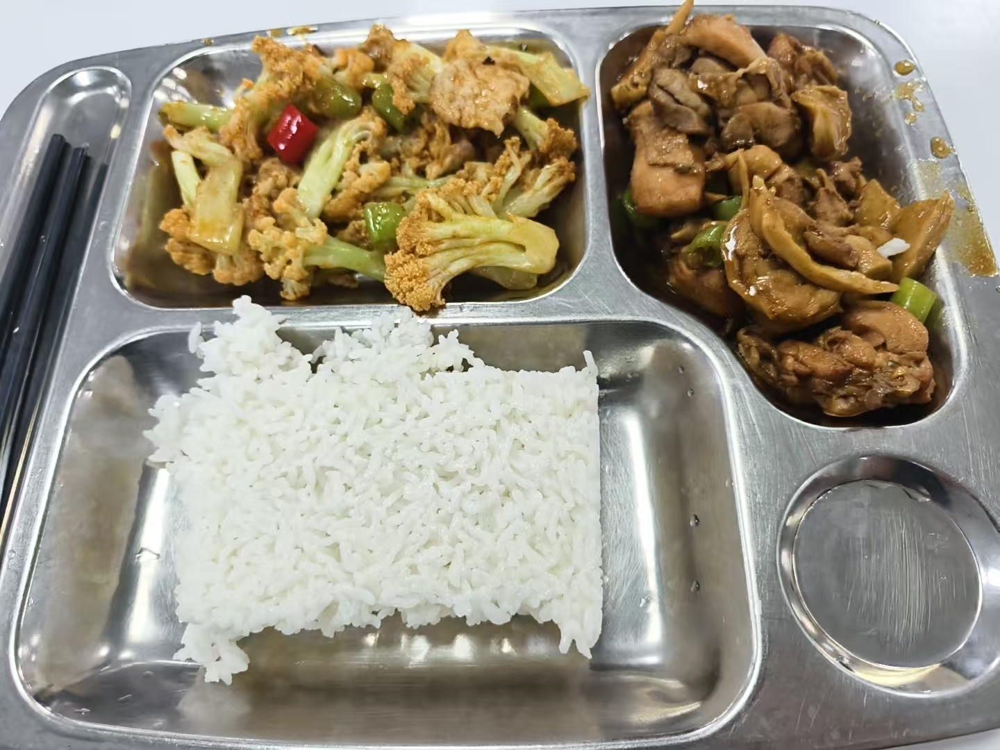

- **面试时间**：2026 年 9 月 18 日、19 日
- **面试地点**：农大东校区（海淀区，六道口）
- **面试形式**：双盲。老师不知道你的情况，学生也不用材料，不用准备 PPT，纯交流。

## 9 月 17 日：材料审查

9 月 17 日下午 2 点，北京交通大学面试结束，没有想象中的那么压力，心里无比轻松，感觉第二天的农大也不在话下。在小卖部买了瓶脉动电解质，沿着鲲鹏路出校门。回到酒店换下了面试的衣服，休整一下，准备去中国农业大学审查复试材料。

下午 4 点 40 分，到了农大门口，门禁得刷脸，来面试的话就得刷身份证进，但是感觉在身份证放下之前，门就已经开了。到了工学院，人很多，也见到了上午在北交面试的河北农业大学那哥们。但我到现在都不知道这哥们叫啥，也不知道他有没有被农大录取。

5 点 10 分，审查结束，过程很松，估计都是研究生或者博士生在审，没有老师。我在校园里逛了逛，明显比北交宽敞，不过校园也没有想象中那么大，不一会儿就到了食堂。

都说农大的食堂是京城第一食堂，的确不赖，但依旧不能使用微信支付，所以也是问一个同学借了卡。一个五花肉炒花菜、一个香菇鸡块，10 块，外加二两米饭 5 毛，10.5，正常价格。（吐槽一下，怎么北京学校的米饭都是单独收费？）味道很不错，比自个学校食堂好吃。

饭后回了酒店休息。

## 9 月 18 日：英语与政治素养面试

### 候场

9 月 18 号，复试内容是**英语和政治素养**。复试名单中，我排在 90 位左右，所以一定是下午。我在酒店待到了中午，出去吃饭的时候去了一趟农大，面试考场门口的工作人员是个博士生。

> “哥，请问现在到几号了？”
>
> “现在 40 多号了，你是几号啊？”
>
> “我好像是 90 多号。”
>
> “那你可以出去玩了。”
>
> “啊？”
>
> “没事，很晚才能到你，快到你的时候给你打电话。”
>
> “好嘞，谢谢哥。”

然后我就走了，也正好到饭点了，但是我不敢吃其他东西，怕下午坏肚子。所以在附近一个商场吃了必胜客。吃完回了酒店，顺便面试了哈工程（线上）。

下午 3 点 30 分，我接到了通知去复试的电话，因为天气比较热，我怕汗弄湿了面试的衣服，所以尽管只有 1 km，但还是打车过去的。

到了门禁前，我正在掏身份证，不经意间看了一眼摄像头，叮～，门开了。“嗯？”然后发现，是门禁把我识别成了别的同学，难怪昨天会在身份证刷上去之前开门。

到了面试房间的门口，我前边还有 4 个人，一个人 10 分钟，所以还有 40 分钟，我淦，早知道晚来会儿了。

经历了昨天北交的面试，觉得没有那么难，但是真站在农大面试考场的门前，说不紧张是不可能的。我在门前不停地徘徊，端着手机背英文自我介绍（截至目前，我一遍都没有完整背下来过）。

突然，手机震了起来，是唐山的电话号码，我跑开了……（为了叙事连贯性，[后续请看结尾的花絮](#花絮候场时的那通电话)。）

接完电话回来，继续背英文自我介绍，也时不时和门口的博士生唠两句。时间过得很快，我前边那人进去了，这时紧张的心达到了顶点，尽管嘴上英语念叨得很快，但是一点都进不了脑子。

我感觉此刻有两个我，一个拽着我的左手让我走神，另一个拽着我的右手要好好背诵，我都想让他俩打一架，然后我在旁边坐着啥也不干。就这么僵持了 10 分钟，门开了，那个哥们走了出来，我走了进去。

### 英语面试

走进去的一瞬间，紧张感就没有了，我发现我总是这样，事前紧张，事中就有破釜沉舟、背水一战的感觉，什么也不怕。（事后又会复盘之后不断地悔恨）

考场原来像是一个办公室，桌子被排成了圆形摆在中央位置，三个老师背对着窗户坐在一边，另一边只有一张椅子，这很明显是我的位置。我朝老师鞠了个躬，然后坐下，开始面试。

英文自我介绍，虽然部分有些磕巴，但整体也算流畅，而且我觉得我的发音和语调还算标准，挺好的，这关算过。

正当我庆幸时，整个面试最难的部分来了，纯英文的压力，各种反问，打得我措手不及，与网上说的英文问题完全不一样啊 😭

**网上说的英文复试 be like：**

> “Could you introduce your hometown?”
>
> “What's your favorite sport? Why do you like it?”
>
> “What is your favorite festival? Why?”

**我遇到的英文复试 be like（纯英文回答）：**

> “描述一下你做科研、发论文的步骤。”
>
> “四区很没含金量啊，你为什么要投它？”
>
> “你刚刚提到……，这是不是表明你对科研没有兴趣？”

哎呦我去了，不过好在一点点憋出来了，有惊无险。

### 思政题

最后是思政题，1 个问题，中文回答，就是把问题往国家政策上扣，这点和网上的资料是一样的，主要就是**三农问题、机械绿色化、粮食安全**等等等（毕竟是农业大学）。

就这样，农大第一天的面试就结束了。

## 9 月 19 日：专业综合面试

### 开场

我的名字依旧在面试名单的后面，所以还是下午，不着急。等到工作人员给我打电话，我就过去了。

到了面试等候区，前边还有 3 个人，也很快了。第一天的英语面试还能背一背自我介绍，今天的专业课怎么都没招了，纯硬等。

进了考场后，吓了一跳，这是一个会议室，一个大长桌子，6 个老师坐对面。**1v6 啊，不是哥们，我不是叶问啊。** 😭

不过我坐的位置不是凳子，是带垫子的椅子，尽管我不敢倚着，但还是挺舒服的，这让我稍微放松了下来。

先是中文自我介绍。

### 专业课

随后是三个专业课问题。三个模块选一个模块回答，**我选的机制，另外两个是车辆和农机。三个问题，有一次换题机会。**

> “第一个问题，……”
>
> “额……换一题。”

是的，第一题我就用了换题卡。

> “好，请问……”
>
> “￥%@#%%”

不会，所以胡乱说了一通。

> “第二题，……”

我靠，这题我看到过！诶？答案什么来着？“￥%@#%%”回答上来了算半个吧。

> “第三题，……”

嗯嗯嗯依旧是“￥%@#%%”，什么都不知道。

就这样，专业课问题就结束了，没错，算是 4 个问题，我只回答上来半个，当时就觉得没希望了。

### 科研与项目经历

但是后面的科研和项目经历，老师面试得很认真，问得很多很细致，即便是面试时间的计时器响了，老师仍然多面了我 2 分钟，我也都答了个差不多。但是由于专业课问题回答得一般，有点失落，所以回答得没有那么有激情。

之后就结束了，回酒店收拾行李，由于晚上还有江南大学的线上面试，可海淀区一晚上 450 块的酒店实在住不起了，所以我去了昌平。

当天晚上就出了复试结果排名，不算靠前，但也不靠后，因为出指标不敢保证一定能录，很有机会只能说是。

## 花絮：候场时的那通电话

突然，手机震了起来，是唐山的电话号码，我猜到了，是西南交通大学唐山研究院。保研这事，去多个学校面试，有多个 offer 都是很正常不过的事情，但还是很忌讳被老师知道你在养鱼。所以我立马跑开，接了电话。

> “你好，这里是唐山研究院，请问是 skp 吗？”
>
> “是的。”
>
> “请问你现在有确定去的院校了吗？”
>
> “实不相瞒，我已经参加了北京交通大学的复试，但是目前还是 0 offer。”

突然脑子想起来了，我好像有个 offer？

> “哦对，我目前有深圳大学的铁 offer，但我还是更倾向于西南交通大学这样更好的平台。”

（把深圳大学给忘了。）

> “好的，那如果给你发 offer，你会来吗？”

What？这么直接吗？突然很想笑，但还是得装一下。

> “会的，我非常想留在东部沿海地区上学，如果能拿到贵校的 offer，我一定会去的。”
>
> “好的，记得查收复试通知。”

虽然说得那么肯定，但是两天后，面试我就给鸽了。（难崩）

---

**补充**：深大、哈工程、江南大学等学校的线上面试，我会在另一条帖子中说一说，线上面试还是相对简短的。
